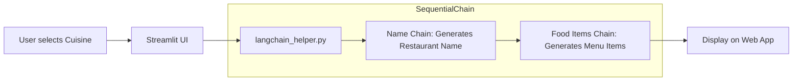

# 🍽️ Restaurant Name Generator AI

An AI-powered web application built with **Streamlit** and **LangChain** that generates creative restaurant names and curated menu items for any selected cuisine, powered locally by **Ollama** (`tinyllama`).

---

## 📌 Features

- **Cuisine Selection**: Choose from popular cuisines such as Indian, Italian, Mexican, Arabic, and American.
- **Sequential LangChain Pipeline**:
  - **Stage 1 (Name Generation)**: Generates a creative and fancy restaurant name based on the selected cuisine.
  - **Stage 2 (Menu Generation)**: Suggests relevant menu items tailored to the generated restaurant name.
- **Local & Private LLM Inference**: Uses [Ollama](https://ollama.com/) with `tinyllama` to run inferences locally without requiring external paid API keys for basic usage.
- **Interactive Web Interface**: Clean and intuitive UI built using Streamlit.

---

## 📁 Project Structure

```text
RestaurantNameGeneratorAI/
├── frontend.py           # Streamlit web application interface
├── langchain_helper.py   # LangChain pipeline setup (OllamaLLM & SequentialChain)
├── demo.ipynb            # Jupyter notebook exploring LangChain concepts & agents
├── .gitignore            # Git ignore configuration
└── README.md             # Project documentation
```

---

## 🛠️ Tech Stack

- **Python 3.9+**
- **[Streamlit](https://streamlit.io/)**: Interactive frontend UI
- **[LangChain](https://www.langchain.com/)**: Multi-step prompt orchestration (`SequentialChain`, `LLMChain`)
- **[Ollama](https://ollama.com/)**: Local LLM runner (using `tinyllama:latest`)

---

## 🚀 Getting Started

### 1. Prerequisites

- Make sure **Python 3.9+** is installed on your system.
- Install **Ollama** from [ollama.com](https://ollama.com/).
- Pull the required model via terminal / command prompt:
  ```bash
  ollama pull tinyllama
  ```

### 2. Clone / Open Repository

```bash
cd RestaurantNameGeneratorAI
```

### 3. Create a Virtual Environment (Recommended)

```bash
# Windows (PowerShell)
python -m venv venv
.\venv\Scripts\Activate.ps1

# Linux / macOS
python3 -m venv venv
source venv/bin/activate
```

### 4. Install Dependencies

Install the required Python packages:

```bash
pip install streamlit langchain langchain-core langchain-ollama langchain-classic
```

*(Optional: if exploring `demo.ipynb`, install `notebook` or `jupyterlab` as well.)*

---

## 💻 Running the Application

1. Ensure Ollama service is running in the background.
2. Launch the Streamlit application:

```bash
streamlit run frontend.py
```

3. Open your browser and navigate to the local URL (typically `http://localhost:8501`).
4. Select a cuisine from the sidebar to generate a restaurant name and its menu items!

---

## ⚙️ How It Works



1. **User input**: The user picks a cuisine (e.g., *Italian*).
2. **Chain 1**: LangChain prompts `tinyllama` to create a fancy restaurant name for that cuisine.
3. **Chain 2**: The generated name is fed into a second prompt to produce a comma-separated list of signature menu items.
4. **Display**: Streamlit parses and displays the restaurant name and menu items.

---

## 📝 License

This project is open-source and available for educational and personal use.

---

## ⚠️ Warning

> **Note:** The `tinyllama` model was used here purely for **learning purposes**. It is an extremely lightweight model and can be **very slow** in response time. Due to its limited capabilities, it may sometimes produce **incorrect or irrelevant answers**.
>
> For better accuracy and performance, consider switching to a more capable model such as:
> - `llama3` — `ollama pull llama3`
> - `mistral` — `ollama pull mistral`
> - `gemma2` — `ollama pull gemma2`
>
> You can swap the model in `langchain_helper.py` by changing the `model` parameter in `OllamaLLM(model="tinyllama")` to your preferred model.

